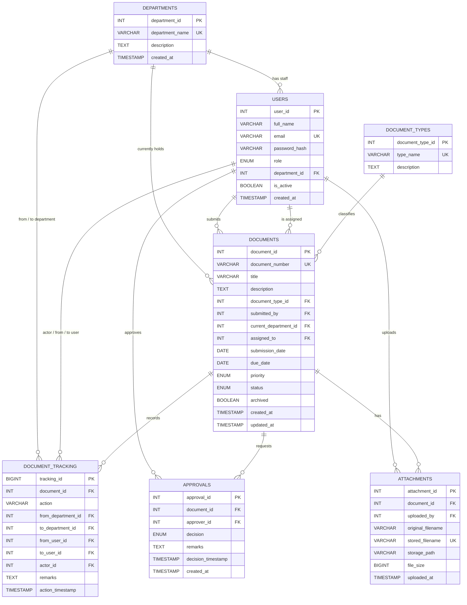

# DocTrack — Office Document Tracking System

DocTrack is a complete Flask + MySQL web application for a college DBMS project.
It tracks an office document from **registration → assignment → forwarding →
approval or rejection → closure → archive**, and records every step in a
permanent audit trail.

The interface is a dark-theme dashboard inspired by modern document-management
apps (sidebar navigation, summary cards, filterable tables, document timeline),
and it works on desktop and mobile.

> This project is a learning/demo application. It applies practical security
> measures (hashed passwords, CSRF tokens, parameterized queries, role checks,
> safe uploads, friendly error pages), but it has **not** been audited and should
> not be described as production-secure.

---

## 1. Features

### Documents
- Register a document with title, description, type, department, assignee,
  submission date, due date, priority and an optional attachment.
- Automatic unique document number (`DOC-YYYY-0001`, derived from the row id).
- Search by document number or title; filter by status, department, type,
  priority and submission-date range; browse paginated results.
- Archived-only view for old records.
- Per-document page with description, details, approval records, attachments
  and a chronological tracking timeline.
- Add remarks to the tracking history at any time.

### Workflow
- Assign an unassigned document to an employee in a department.
- Forward a document to another employee or department with remarks.
- Send a document to a manager/administrator for approval.
- Approve or reject; **rejection requires remarks** (enforced in Flask and by a
  MySQL `CHECK` constraint).
- Close approved or rejected documents, then archive them (read-only).
- Invalid status transitions are rejected by the server.

### Dashboards and reports
- Role-aware dashboard: totals, status counts, overdue count, recent documents,
  department workload, pending approvals and recent tracking activity.
- Reports page built from real SQL views: status breakdown, department summary,
  pending-document ageing, overdue list, recently completed documents.
- CSV export of documents.

### Administration
- Create users, assign roles and departments, activate/deactivate accounts,
  edit users and reset passwords. Password hashes are never displayed.
- Create and edit departments; create and edit document types.
- Foreign-key `RESTRICT` rules prevent deleting reference data that documents
  depend on, so audit history cannot be broken.

### Security measures implemented
- Parameterized SQL everywhere (no string-built queries with user input).
- Werkzeug password hashing; plaintext passwords are never stored.
- Session-based login with a fresh session on login, HttpOnly + SameSite
  cookies, optional Secure cookie flag and 8-hour lifetime.
- CSRF token validation on every POST (`400` if missing/expired).
- Backend role and per-document authorization checks, not just hidden buttons.
- Server-side validation of every form and workflow request.
- Uploads restricted by extension, stored under random names in `uploads/`,
  size-limited, and downloaded only through an authorized route that resolves
  the path inside the uploads folder.
- Friendly `403`, `404` and `500` pages; technical errors are logged to the
  server console, not shown to users.
- No secrets in code; configuration comes from `.env`.

---

## 2. Technology stack

| Layer | Technology |
| --- | --- |
| Language | Python 3.8+ (tested with Python 3.12) |
| Web framework | Flask 3.0 |
| Database driver | `mysql-connector-python` |
| Database | MySQL 8.0+ (tested with MySQL 8.4) |
| Templates | Jinja2 |
| UI | Bootstrap 5.3 + Bootstrap Icons (CDN), custom dark CSS |
| Authentication | Flask sessions + Werkzeug password hashing |
| Tests | pytest |

---

## 3. Database schema and relationships

Database name: `office_document_tracking`

### 3.1 Entity-relationship diagram

The diagram below can be pasted into GitHub, GitLab, VS Code or
<https://mermaid.live> for the report. A plain-text summary follows it for
printed submissions.



Plain-text summary (the same relationships without Mermaid):

```text
departments 1 ──── * users            (a user belongs to one department)
departments 1 ──── * documents        (current_department_id)
users       1 ──── * documents        (submitted_by, assigned_to)
document_types 1 ── * documents

documents 1 ──── * document_tracking  (append-only audit trail)
documents 1 ──── * approvals          (one row per approval request)
documents 1 ──── * attachments        (metadata; files live in uploads/)
```

### 3.2 Relationship reference

`1:N` means one row in the first table relates to many rows in the second.

| Relationship | Cardinality | Foreign key | On delete / update | Why it exists |
| --- | --- | --- | --- | --- |
| `departments` → `users` | 1:N | `users.department_id` (nullable) | `SET NULL` / `CASCADE` | Staff belong to one department. A department can be removed without deleting accounts; those users become unassigned. |
| `departments` → `documents` | 1:N | `documents.current_department_id` (nullable) | `SET NULL` / `CASCADE` | The department currently holding the document. It changes when a document is assigned or forwarded. |
| `users` → `documents` (submitter) | 1:N | `documents.submitted_by` (required) | `RESTRICT` / `CASCADE` | Every document has exactly one submitter. A user who has submitted documents cannot be deleted, preserving ownership history. |
| `users` → `documents` (assignee) | 1:N, optional | `documents.assigned_to` (nullable) | `SET NULL` / `CASCADE` | The employee currently responsible. `NULL` means the document is unassigned. |
| `document_types` → `documents` | 1:N | `documents.document_type_id` (required) | `RESTRICT` / `CASCADE` | Every document has one category. A type that is already used cannot be deleted, so reports stay valid. |
| `documents` → `document_tracking` | 1:N | `document_tracking.document_id` | `RESTRICT` / `CASCADE` | One permanent audit row per workflow event. `RESTRICT` prevents deleting a document and losing its history. |
| `documents` → `approvals` | 1:N | `approvals.document_id` | `CASCADE` / `CASCADE` | Each approval request/decision belongs to one document. A document can be sent for approval more than once over its life. |
| `documents` → `attachments` | 1:N | `attachments.document_id` | `CASCADE` / `CASCADE` | File metadata belongs to the document; the bytes live in `uploads/`. |
| `departments` → `document_tracking` (from / to) | 1:N each, optional | `document_tracking.from_department_id`, `to_department_id` (nullable) | `SET NULL` / `CASCADE` | Two optional links record where a document came from and where it went. A registration event has no source department. |
| `users` → `document_tracking` (actor / from / to) | 1:N each | `document_tracking.actor_id` (required), `from_user_id`, `to_user_id` (nullable) | `RESTRICT` for actor, `SET NULL` for from/to / `CASCADE` | `actor_id` is who performed the action; the optional from/to users describe the previous and new holder. |
| `users` → `approvals` | 1:N | `approvals.approver_id` | `RESTRICT` / `CASCADE` | The manager or administrator responsible for a decision. A user with decisions on record cannot be deleted. |
| `users` → `attachments` | 1:N | `attachments.uploaded_by` | `RESTRICT` / `CASCADE` | Who uploaded the file, for accountability. |

Composite rules worth mentioning in the report:

- `documents.document_number` is unique and generated from the auto-increment id (`DOC-YYYY-0001`), so two documents can never share a number.
- A document always has a type and a submitter, but the assignee and current department may be `NULL` while it is unassigned.
- `document_tracking` is append-only: the application only inserts rows. Deleting a document is blocked by `RESTRICT`, so the audit trail cannot silently disappear.
- `approvals` has CHECK constraints tying `decision` to `decision_timestamp` and requiring non-empty remarks for a rejection.
- `users.email`, `departments.department_name`, `document_types.type_name` and `attachments.stored_filename` are unique.

### 3.3 Tables

| Table | Purpose | Key columns |
| --- | --- | --- |
| `departments` | Office departments | `department_id`, `department_name` (unique), `description` |
| `users` | Staff accounts | `email` (unique), `password_hash`, `role` ENUM, `department_id`, `is_active` |
| `document_types` | Categories of document | `type_name` (unique) |
| `documents` | The document itself | `document_number` (unique), `status`, `priority`, `submitted_by`, `assigned_to`, `current_department_id`, `archived`, date and FK constraints |
| `document_tracking` | Audit history | `action`, actor, from/to department and user, `remarks`, `action_timestamp` |
| `approvals` | Approval decisions | `approver_id`, `decision` ENUM, `remarks`, `decision_timestamp`; CHECK constraints enforce decision/remarks/timestamp consistency |
| `attachments` | Uploaded file metadata | `original_filename`, random `stored_filename`, `storage_path`, `file_size` |

Roles: `admin`, `records_officer`, `employee`, `manager`.

### Advanced database objects

| Object | Type | What it does |
| --- | --- | --- |
| `v_pending_documents` | View | Open documents with type, department, assignee and `pending_days` |
| `v_department_status_summary` | View | Per-department counts for every status |
| `sp_register_document` | Procedure | Validates and registers a document, generates its number, writes audit row via trigger |
| `sp_forward_document` | Procedure | Locks the row, validates, reassigns and records the forwarding |
| `fn_pending_days` | Function | Days a document has been waiting (0 when finished/archived) |
| `trg_documents_after_insert` | Trigger | Writes the "Document registered" audit row |
| `trg_documents_after_update` | Trigger | Writes the audit row when status changes or a document is archived |
| Indexes | — | On status, (department, status), submission date, (assignee, status), archived, tracking timestamps, approval lookups |

The workflow logic and permissions live in `workflow.py`, and every route uses
them, so buttons in the UI and backend rules cannot disagree.

---

## 4. Prerequisites

- Python 3.8 or newer
- MySQL 8.0 or newer (the server, the `mysql` command-line client, and a user
  that can create databases, tables, views, procedures, functions and triggers)
- Git (optional, for cloning)
- A terminal: **PowerShell** on Windows, Terminal on Linux/macOS

---

## 5. Install Python dependencies

From the project root.

**Windows PowerShell**

```powershell
python -m venv .venv
.\.venv\Scripts\Activate.ps1
python -m pip install --upgrade pip
python -m pip install -r requirements.txt
```

If PowerShell blocks activation, run
`Set-ExecutionPolicy -Scope Process -ExecutionPolicy Bypass` once in that window.

**Linux / macOS**

```bash
python3 -m venv .venv
source .venv/bin/activate
python -m pip install --upgrade pip
python -m pip install -r requirements.txt
```

---

## 6. Install and start MySQL

### Windows

1. Download **MySQL Installer** from <https://dev.mysql.com/downloads/installer/>.
2. Choose *MySQL Server* (and optionally *MySQL Workbench*), install it, and set
   a root password during setup. Keep that password — it goes into `.env`.
3. Start the server. If you installed it as a Windows service:
   ```powershell
   Get-Service *mysql*
   Start-Service MySQL84        # use the exact service name shown above
   ```
4. Check that the client works:
   ```powershell
   mysql --version
   mysql -u root -p
   ```
   If `mysql` is not recognized, add the MySQL `bin` folder to your PATH
   (usually `C:\Program Files\MySQL\MySQL Server 8.4\bin`), or call the client
   with its full path.

### Linux (Debian/Ubuntu)

```bash
sudo apt update
sudo apt install mysql-server
sudo systemctl start mysql
sudo mysql_secure_installation
mysql --version
```

### macOS (Homebrew)

```bash
brew install mysql
brew services start mysql
mysql_secure_installation
mysql --version
```

### Using a non-default port

If MySQL listens on another port (for example a portable server on `3307`), set
`MYSQL_PORT` accordingly in `.env`. `scripts/init_db.py` and the Flask app both
read the same `.env`.

---

## 7. Configure environment variables

Copy the example file and edit it.

**PowerShell**

```powershell
Copy-Item .env.example .env
```

**Linux / macOS**

```bash
cp .env.example .env
```

`.env`:

```ini
SECRET_KEY=replace-with-a-long-random-string
FLASK_DEBUG=1

MYSQL_HOST=127.0.0.1
MYSQL_PORT=3306
MYSQL_USER=root
MYSQL_PASSWORD=your-mysql-password
MYSQL_DATABASE=office_document_tracking

SESSION_COOKIE_SECURE=0
MAX_UPLOAD_SIZE=5242880
```

Generate a real secret key instead of typing one:

**PowerShell**

```powershell
python -c "import secrets; print(secrets.token_urlsafe(48))"
```

**Linux / macOS**

```bash
python3 -c "import secrets; print(secrets.token_urlsafe(48))"
```

Paste the output into `SECRET_KEY`. `.env` is ignored by Git and must never be
committed. `.env.example` is the safe template.

| Variable | Meaning |
| --- | --- |
| `SECRET_KEY` | Signs the session cookie. Use a unique random value. |
| `FLASK_DEBUG` | `1` enables debug/reload locally. Use `0` otherwise. |
| `MYSQL_HOST` / `MYSQL_PORT` | Where MySQL listens. |
| `MYSQL_USER` / `MYSQL_PASSWORD` | Database credentials. |
| `MYSQL_DATABASE` | Defaults to `office_document_tracking`. |
| `SESSION_COOKIE_SECURE` | `1` only when serving over HTTPS. |
| `MAX_UPLOAD_SIZE` | Maximum upload size in bytes (default 5 MiB). |

---

## 8. Create the database

### Option A — initialization script (recommended)

```powershell
python scripts\init_db.py
```

```bash
python scripts/init_db.py
```

This applies, in order:

1. `sql/schema.sql` — database, tables, constraints, indexes
2. `sql/advanced_features.sql` — views, procedures, function, triggers
3. `sql/seed.sql` — example departments and document types

> **Warning:** `schema.sql` drops and recreates the application tables. Running
> the script on a database with data you need will delete that data.

### Option B — MySQL client

```powershell
mysql -u root -p
```

```sql
SOURCE sql/schema.sql;
SOURCE sql/advanced_features.sql;
SOURCE sql/seed.sql;
EXIT;
```

Run the `SOURCE` commands from the project root. On Linux/macOS you can also use
redirection:

```bash
mysql -u root -p < sql/schema.sql
mysql -u root -p office_document_tracking < sql/advanced_features.sql
mysql -u root -p office_document_tracking < sql/seed.sql
```

> On PowerShell, `<` redirection is not supported by older versions; use the
> `SOURCE` method or `Get-Content sql\schema.sql | mysql -u root -p`.

---

## 9. Create development users and demo documents

```powershell
python scripts\seed_db.py
```

```bash
python scripts/seed_db.py
```

This creates five accounts (password for all: `Password@123`) and seven sample
documents in different workflow states so the dashboard is not empty.

| Role | Email | Department |
| --- | --- | --- |
| Administrator | `admin@doctrack.local` | Administration |
| Records Officer | `officer@doctrack.local` | Administration |
| Manager / Approver | `manager@doctrack.local` | Finance |
| Employee | `employee@doctrack.local` | Finance |
| Employee | `hr@doctrack.local` | Human Resources |

These are development credentials only. Change or delete them before any real
use. The script is safe to re-run: it updates the accounts and only inserts demo
documents when the `documents` table is empty.

---

## 10. Run the application

```powershell
python app.py
```

```bash
python app.py
```

Open <http://127.0.0.1:5000> and sign in.

For a different port:

```powershell
python -m flask --app app run --port 5001
```

```bash
python -m flask --app app run --port 5001
```

The development server is for local demonstration only. For anything shared, use
a production WSGI server (for example waitress or gunicorn) behind HTTPS.

---

## 11. Try the complete workflow

Sign in as each user in a separate browser window (or log out/in).

1. **Register** — log in as `officer@doctrack.local`, open *Register Document*,
   fill the form, attach a PDF/PNG/JPG/DOCX, and submit. You land on the new
   document page with a number like `DOC-2026-0008` and a first tracking event
   "Document registered".
2. **Assign** — on the document page click *Assign*, choose an employee in the
   department, and submit. Status becomes *In Progress*; a tracking event
   "Document assigned" appears.
3. **Forward** — log in as that employee, open the document from
   *My Assignments*, click *Forward*, choose another department/employee, and
   submit. Status becomes *Forwarded* and the event is recorded.
4. **Send for approval** — log in as the records officer, open the document,
   click *Send for approval*, choose the manager. Status becomes *Pending* and a
   pending approval row is created.
5. **Reject** — log in as `manager@doctrack.local`, open *Pending Approvals*,
   click *Reject* with an empty remark. The app refuses and asks for a reason.
   Add a reason and reject. Status becomes *Rejected*, the approval record stores
   the remark, and a tracking event is added.
6. **Approve** — repeat the flow with another document and choose *Approve*;
   status becomes *Approved*.
7. **Close and archive** — as the records officer, open the approved/rejected
   document and click *Close*, then *Archive*. Archived documents are read-only.
8. **Invalid action check** — try to close a document that is still *Pending*.
   The request is refused (403) and the status does not change.
9. **Access check** — log in as the HR employee and try to open a Finance
   document you are not involved in (`/documents/<id>`). You receive 403, and the
   document does not appear in your list, search results or CSV export.
10. **Uploads** — attachments can be downloaded only by users allowed to see the
    document; a `.txt` upload is rejected with a friendly message.

### Verify tracking history

- On any document page, the **Tracking history** timeline lists every event with
  the actor, timestamp, from/to department/user and remarks.
- *Tracking History* in the sidebar shows the office-wide log, searchable by
  document number/title, action and date range.

---

## 12. Run the automated tests

The suite uses a separate database, `office_document_tracking_test`, and creates
and drops it automatically. The configured MySQL user must be allowed to create
databases.

```powershell
python -m pytest -q
```

```bash
python -m pytest -q
```

Covered: login/logout, CSRF enforcement, hashed passwords, deactivated accounts,
role permissions, document-level access control, registration and document
numbering, assignment, forwarding, approval, rejection (with mandatory remarks),
closure, archival, rollback of failed transactions, attachment authorization and
type validation, search/filter, reports and CSV export, triggers, views,
procedures, function, constraints and indexes.

**Result on the development machine (2026-10-29):** `33 passed`.

The tests connect to the MySQL server from `.env`, so start MySQL first.

---

## 13. Inspect the database objects in MySQL

```powershell
mysql -u root -p office_document_tracking
```

```sql
-- Tables
SHOW TABLES;

-- Views
SHOW FULL TABLES WHERE Table_type = 'VIEW';
SELECT * FROM v_pending_documents;
SELECT * FROM v_department_status_summary;

-- Procedures and function
SHOW PROCEDURE STATUS WHERE Db = DATABASE();
SHOW FUNCTION STATUS WHERE Db = DATABASE();
SHOW CREATE PROCEDURE sp_register_document\G
SHOW CREATE PROCEDURE sp_forward_document\G
SHOW CREATE FUNCTION fn_pending_days\G

-- Triggers
SHOW TRIGGERS;
SHOW CREATE TRIGGER trg_documents_after_insert\G
SHOW CREATE TRIGGER trg_documents_after_update\G

-- Indexes
SHOW INDEX FROM documents;
SHOW INDEX FROM document_tracking;
SHOW INDEX FROM approvals;

-- Function demo (replace 1 with a real document id)
SELECT document_id, document_number, status, fn_pending_days(document_id) AS pending_days
  FROM documents;

-- Procedure demo
CALL sp_register_document(
  'Demo procedure document', 'Created from MySQL', 3, 1, 2, NULL,
  CURDATE(), DATE_ADD(CURDATE(), INTERVAL 7 DAY), 'Normal', @new_id
);
SELECT @new_id;
```

Note: calling `sp_forward_document` or changing `status` directly in SQL still
writes audit rows because of the triggers. The Flask app also sets
`@tracking_action`, `@tracking_actor_id` and `@tracking_remarks` before its
updates so the audit trail gets a human-readable action and remarks.

---

## 14. Common errors and fixes

| Symptom | Cause and fix |
| --- | --- |
| `'mysql' is not recognized` | MySQL `bin` folder is not on PATH. Add it, or use the full path to `mysql.exe`. |
| `Access denied for user 'root'@'localhost'` | Wrong password in `.env`, or MySQL requires a different user. Update `MYSQL_PASSWORD`. |
| `Can't connect to MySQL server on '127.0.0.1'` | MySQL is not running, or the port is wrong. Start the service and check `MYSQL_PORT`. On Windows: `Start-Service MySQL84`. |
| `Unknown database 'office_document_tracking'` | Run `python scripts/init_db.py` (or the `SOURCE` commands) first. |
| `Table 'office_document_tracking.v_pending_documents' doesn't exist` | `sql/advanced_features.sql` was not applied. Run it, then restart Flask. |
| Registration succeeds but no "Document registered" audit row | Triggers are missing. Re-apply `sql/advanced_features.sql`. |
| `cryptography package is required` (MySQL 8 auth) | `pip install cryptography` (already listed in `requirements.txt`). |
| `OSError: [WinError 10048] ... port 5000` | Another program uses port 5000. Stop it, or run on another port. |
| `Address already in use` on Linux | `lsof -i :5000` to find the process, or use another port. |
| 500 error after editing `.env` | Stop and restart `python app.py` so the new settings load. |
| Login says invalid password after re-seeding | Run `python scripts/seed_db.py` again; it resets the demo password to `Password@123`. |
| Upload rejected | Only PDF, PNG, JPG, JPEG and DOCX up to `MAX_UPLOAD_SIZE` (5 MiB) are accepted. |
| `pytest` cannot create the test database | Grant the MySQL user database-creation rights, or create `office_document_tracking_test` manually and grant access. |

---

## 15. Project structure

```text
app.py                     Application factory, error handlers, dev entry point
config.py                  Environment-based configuration
db.py                      Connections, query helpers, transactions, tracking helpers
auth.py                    Login/logout, CSRF, session loading, role decorators
workflow.py                Statuses, transitions and permission rules
routes/
  dashboard.py             Dashboard metrics and recent activity
  documents.py             Registration, listing, details, workflow actions, uploads
  approvals.py             Pending approvals and decisions
  tracking.py              Office-wide tracking history
  reports.py               Reports and CSV export
  admin.py                 Users, departments, document types
  common.py                Shared queries, visibility scope, template helpers
templates/                 Jinja layout, pages and friendly error screens
static/css/style.css       Dark theme design system
static/js/main.js          Sidebar, auto-submit filters, confirmations
sql/schema.sql             Database and tables
sql/advanced_features.sql  Views, procedures, function, triggers
sql/seed.sql               Departments and document types
scripts/init_db.py         Applies all SQL files
scripts/seed_db.py         Development accounts and demo documents
tests/                     pytest suite (real MySQL test database)
uploads/                   Protected attachment storage (not committed)
.env.example               Configuration template
```

---

## 16. Known limitations

- Built for a **single office installation**: attachments are stored on local
  disk, so multiple app servers need shared storage.
- The Flask development server and SQLite-style demo scale are not intended for
  production traffic; use a WSGI server, HTTPS, backups and monitoring.
- No email notifications, password reset email, file versioning or full-text
  search.
- Approval routing is one approver per request.
- Archived documents are read-only and cannot be restored from the UI.
- Development accounts and demo data are included for demonstration only.
